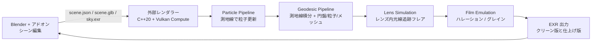

# アーキテクチャ

## コンポーネント

| コンポーネント | 場所 | 役割 |
|---|---|---|
| Blender アドオン | `blender_addon/` | パネル UI、scene.json / glb 書き出し、レンダラー呼び出し、EXR 読み込み |
| レンダラー本体 | `renderer/` | パイプライン群、測地線積分 (GLSL)、レンズ/フィルム段 |
| 物理ヘッダ | `renderer/include/bh/` | 単位換算、ISCO 等の基礎量 (CPU/GPU 共有の定義置き場) |
| リファレンス実装 | 外部: BHraytracer | Phase 0 検証済み CPU 実装。移植時の正解の物差し |

## データの受け渡し

- `scene.json`: カメラ、ブラックホール (M, a)、円盤、パーティクル、
  レンダー設定、レンズ、フィルムの全パラメータ (仕様は
  `docs/spec/blender-addon.md`)
- `scene.glb`: 主役メッシュのみ
- `sky.exr`: 背景の天球テクスチャ
- 出力: リニア HDR EXR (クリーン版と、フレア+フィルム適用版の2種)

詳細な物理とパイプライン仕様は `docs/spec/` が正本。
